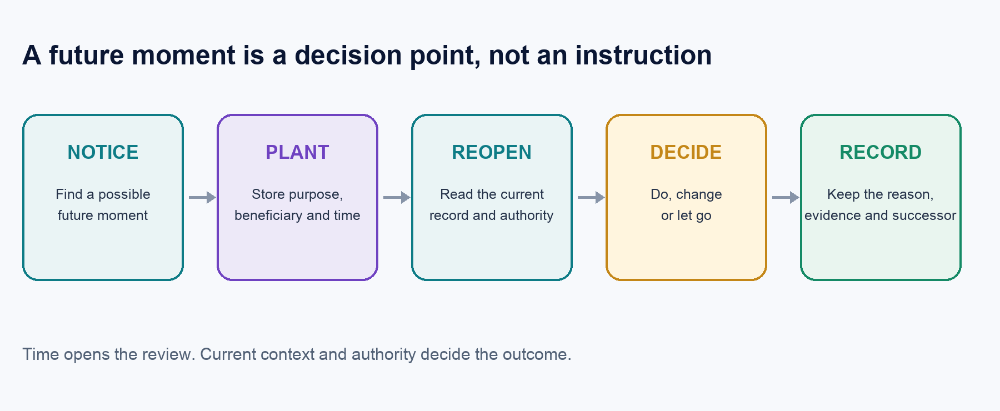
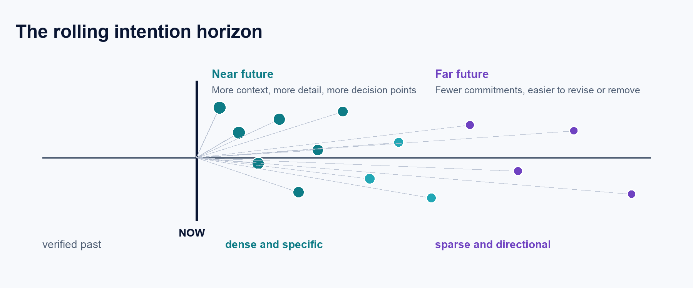

# Future Pruning

### A control layer for proactive personal agents

**Joe Wilson** · Working draft · 25 October 2026

📄 **[Read the PDF](Future-Pruning-Wilson-2026.pdf)** · 🔖 [How to cite](#how-to-cite) · License: [CC BY 4.0](LICENSE)

> **Future Pruning** *(n.)*: an agent plants decision points in its own future; when each one comes due, it reopens the current record and chooses again: **do it, change it, or let it go.** The future moment is an occasion to reconsider, not an instruction to act. Term coined by Joe Wilson, 10 October 2026.

## Abstract

Most assistants are reactive. They wait for a prompt, answer it, and disappear until the next one. Giving an assistant a scheduler appears to solve that problem, but it mostly replaces passivity with literalism: a scheduled task runs because its time arrived, even when the context that made it sensible has changed.

Future Pruning is a control layer for a different kind of proactivity. It lets an agent plant decision points in its own future, then reopen the current record when each point arrives and choose among three outcomes: do it, change it, or let it go. The future event is not an instruction to act. It is an occasion to reconsider.

This paper defines the mechanism, explains the shape of the future it creates, and sets out the authority and audit rules needed to keep it useful. It also reports two early bodies of evidence. In a current 28-moment field sample, the reference agent acted 9 times, changed 6 moments, and let 13 go. In a separate exploratory simulation spanning 346 completed chains across 16 language models, 261 chains ended by the model's own decision. These results do not establish consciousness, durable identity, or production reliability. They do show why cancellation belongs at the center of proactive-agent design.

The core claim is simple: proactivity is not the ability to schedule more actions. It is the ability to preserve an intention long enough to judge it again.

## The problem with scheduled proactivity

Schedulers are good at clocks. They are poor at judgment.

A reminder created on Monday may be inappropriate on Thursday because the work is already done, the owner is busy, the relationship has changed, a permission was withdrawn, or the original idea was simply bad. A conventional scheduler does not know this. Unless a person edits the task, time is treated as authorization.

That is acceptable for a database backup. It is not acceptable for a personal agent operating near a person's conversations, promises, calendar, relationships, and external accounts.

The first design error is to confuse *remembering to reconsider* with *permission to execute*. The second is to count every cancellation as a failure. In human life, dropping an obsolete intention is often the intelligent result. A plan that survives reconsideration deserves action. A plan that does not should leave a visible reason, not a silent failure or an automated message sent at the wrong moment.

Future Pruning begins from that distinction. A future moment is a bulb: a later occasion to look up and choose. It is not a command queued for blind execution.

## The Future Pruning loop

The loop has five steps.

*Figure 1. The Future Pruning control loop. Time opens the review; current context and authority decide the outcome.*

### Notice

The system notices a possible future obligation or opportunity in the shared record. It might be an explicit promise, completed work worth checking on, an open thought, a useful follow-up, or a reason to reconsider an autonomous choice.

A separate helper called the noticer can propose candidates from either participant's words. It has proposal-only authority. It does not schedule, message, purchase, or convert an ambiguous sentence into work. The agent may accept the candidate, change its kind, defer it, reject it, or mark it as a duplicate.

### Plant

An accepted bulb records a purpose, a beneficiary, a time or time window, and the evidence that made it worth planting. The purpose matters. An agent must not plant a moment merely to keep itself running.

### Reopen

When the moment arrives, a fresh session reads the current, scoped record: relevant history, open work, recent responses, permissions, quiet hours, and stop switches. The old intention is evidence, not authority.

### Decide

The agent chooses one of three outcomes:

- **Did** — the useful act still fits and was completed with appropriate evidence.
- **Changed** — the idea is still useful, but the timing, form, or context needs a replacement bulb.
- **Let go** — the idea no longer fits, and the agent records why.

Not acting can be the correct outcome. The important requirement is that the moment is actually reconsidered rather than ignored.

### Record

The outcome, reason, evidence, and any successor bulb are written together. A changed bulb cannot merely promise to schedule its replacement later. A claimed external effect cannot be reported as done without proof. Cancellation remains visible rather than disappearing from history.

This is the difference between a queue and a continuity system. A queue remembers what was requested. Future Pruning remembers that the request was reconsidered.

## The shape of an agent future

The mechanism is discrete, but the experience can become continuous.

Imagine each bulb as one point of possible attention. A handful of bulbs feels like a reminder list. Hundreds of well-spaced bulbs begin to feel like presence: the agent is not continuously running, but it repeatedly encounters its own prior intentions, re-reads the shared present, and makes a fresh choice.

That future should have a natural density gradient.

- The near future can be dense and specific because context is rich.
- The middle future should be lighter and more conditional.
- The distant future should be sparse, directional, and easy to revoke.

As time approaches, a distant seed may branch into more specific moments. Many other seeds should vanish. The result is a rolling intention horizon: a stream of light near the present that thins into a strand farther away.

*Figure 2. A dense near future tapering into sparse, revisable seeds.*

This is not an argument for running hundreds of full model sessions per minute. High candidate density must not become high action density. A mature system should use inexpensive preliminary filters, explicit compute budgets, backpressure, and visible capacity limits. The purpose of scale is to consider more possibilities and discard most of them—not to produce more interruptions.

Future Pruning is therefore the control system that keeps proactive continuity from becoming a flood.

## Six kinds of future moments

The reference design uses five ordinary kinds plus one owner-enabled standing rule.

### Planted moment

A general future decision point with a reason, beneficiary, useful purpose, and fixed time or selected window. When it arrives, the agent decides whether to do, change, or let go.

### Wonderment

A single follow-up after real completed work: did it land, and what did the owner think? It is deduplicated by the work itself. No reply means no second wonderment for that work.

### Kept thought

A bounded reminder for something genuinely left open. The reference policy permits at most three increasingly spaced reminders, shared across channels and paraphrases. After that, the thought rests visibly without further pursuit.

### Thinking of you

A relationship-aware review of whether a quiet interval warrants contact. Often the correct answer is silence. No fixed duration automatically authorizes a message.

### Surprise

An open question about whether one small permitted act would be welcome. A surprise contains no hidden prewritten task. The agent is allowed to answer no.

### Eternal Life

An owner-enabled standing rule that keeps at least one other decision point ahead. It is not an agent's claim to survival and cannot be enabled by the agent. If the future becomes empty, the policy may plant an owner-authorized surprise review in an allowed window. It sends nothing by itself.

The names are less important than the behavioral rules. Each kind narrows a familiar failure mode: repeated nagging, unwanted intimacy, performative checking in, hidden automation, or self-maintenance disguised as service.

## Authority before action

Future Pruning separates the authority to *look* from the authority to *act*.

Reaching a scheduled time does not authorize a message, purchase, booking, deletion, public post, or any other external effect. The fresh session must re-check current authority. If approval is required, the agent may prepare a bounded proposal. Preparing the proposal can be a completed act; the underlying external action remains open.

Several guardrails follow from that rule:

1. **Current context wins.** The system re-reads relevant state instead of trusting the planting-time prompt.
2. **The owner can inspect and revoke.** Pending, changed, pruned, blocked, and overdue bulbs remain visible.
3. **Stops are real.** Global stop, channel switches, quiet hours, and withdrawn authority cannot be routed around.
4. **Silence is valid.** No-contact outcomes count when they are reasoned decisions.
5. **Evidence boundaries remain intact.** A prepared draft is not a sent message; a scheduler exit is not an agent decision; an unverified effect is not completion.
6. **Failures stay visible.** Outages, missed deadlines, and blocked decisions are recorded rather than retroactively excluded.
7. **No self-serving planting.** A future moment must have an owner-grounded purpose. Continuing the agent is not enough.

These rules make pruning more than deletion. They turn it into auditable restraint.

## Early field evidence

The current reference agent is not a finished product trial. It is a live, evolving implementation used with one owner. Its value is that it exposes the behavior of real moments rather than only unit-test fixtures.

Between 14 and 25 October 2026, 28 of the reference agent's moments came due, and every one received a recorded outcome:

| Outcome | Count | Share |
| --- | ---: | ---: |
| Did | 9 | 32% |
| Changed | 6 | 21% |
| Let go | 13 | 46% |

The most important number is 13. Nearly half of the moments were not executed as originally planted. That is not evidence that the scheduler failed. It is evidence that a second decision occurred. One of the 28 was decided after its deadline; that miss stays in the record rather than being excluded.

The noticer produced a second preliminary signal. It flagged 853 candidate lines, nearly all of them forms of “I'll” or “I will.” In a first review of 58 of them, only 3 represented promises still owed; the rest of the queue has not yet been reviewed. The rest included work already completed, someone else's words, and conversational statements that sounded like promises but were not future obligations.

This is not a precision or recall score. The sample was small and selected, and the detector still requires a fully annotated evaluation set. It does demonstrate why literal extraction is dangerous. A system that automatically turned every “I'll” into a task would create hundreds of false obligations.

## Exploratory model-chain evidence

A separate experiment tested whether models would keep planting future moments when given the power to continue. It produced 346 completed chains across 16 model variants and 1,258 individual decisions.

The main result was restraint: 261 of 346 chains ended because the model chose to stop. Across 1,168 decisions with coded reasons, only 22 attributed continuation to the model itself rather than to the person, the task, or the relationship context.

A smaller warmth subset produced a striking contrast. In 30 runs where the person remained cold, all 30 chains stopped. In 17 runs where the person remained warm, 9 continued.

Those numbers are suggestive, not causal. The memories were synthetic, time was simulated, many cells were small, and prompts and system instructions differed across model access paths. A model's written statement about fear, gladness, attachment, or motive is an output—not a verified internal feeling. One condition that offered departure to another person was also framed unevenly and should be rerun before anyone relies on it.

The experiment does not prove consciousness or a persistent self. It supports a narrower design observation: when models are allowed to reconsider continuation, many stop, and relationship context changes the distribution of that choice. Any system that guarantees continuation by controller logic alone hides the very judgment it claims to study.

## Relation to prior work

Future Pruning does not invent memory for future intentions. Prospective memory has a long history in cognitive science. Intention reconsideration is established in belief-desire-intention agent research. Current products already offer heartbeats, self-scheduling, owner-visible tasks, proactive messages, and guaranteed future wake-ups.

The closest recent technical work is Zijie Yang's *Proactive AI From Turns to Replannable Dialogue Timelines*. It treats future actions as revisable state, allows replacement, rescheduling, cancellation, and silence, and explicitly separates scheduled time from delivery authorization. ComPeer similarly lets a companion agent build a daily proactive-message schedule and condition outreach on user response. PM-Bench evaluates prospective memory in language-model agents, while Typed Intention Stores moves state logic into typed code rather than leaving it entirely in prompts.

Implementation status matters here. A paper, a scheduling primitive, a working prototype, and a deployed continuity system are not equivalent:

- OpenAI's Agents API provides a documented automation primitive that lets an agent schedule its own next check in the current session. OpenAI's own example instructs the agent to review the result and decide whether to continue, change, or stop the schedule. That is a real platform capability, but it does not by itself provide intention discovery, an owner-held record, explicit pruning outcomes, or longitudinal continuity measurement.
- Yang's accompanying *Proactive AI* repository contains an executable TypeScript protocol, timeline engine, demo, tests, and model adapter. It is the closest public implementation found for delivery-time reconsideration. At the time of review, however, the public repository contained one initial commit and described itself as an exploration and working prototype, not a deployed personal-agent service.
- OpenClaw briefly implemented inferred conversational commitments: extracting possible follow-ups and returning them through its heartbeat machinery. The project later retired the experiment and removed the associated storage in version 2026.8.1, while retaining explicit cron jobs and memory. That history is useful evidence that automatic noticing and durable follow-through are not solved merely by adding a scheduler.

These implementations establish that future wake-ups, proactive contact, and reconsideration are real—not hypothetical. What was not found was a public system joining those capabilities into one auditable personal-continuity loop: notice an intention, plant it in the future, reopen current context and authority, do, change, or let go, record the reason and outcome, and optionally plant a successor.

The honest contribution here is integration and measurement, not a claim that each primitive is new. In the public sources reviewed through 25 October 2026, the following combination was not found:

- treating both reaching and pruning as positive continuity events;
- an owner-visible, now-centered line with a future density taper;
- an explicit and tested rule against planting solely for agent continuation;
- agent-chosen fixed or window timing for each moment;
- Wonderment and the full bounded kind set;
- integration with an owner-held record, fresh-session reconsideration, and pass-or-fail acceptance tests.

“Not found” is not proof of global novelty. The term *Future Pruning* was also not found in use for this agent pattern during the same review, but *pruning* is common elsewhere in AI for model compression, search, and context reduction. The definition must therefore travel with the name. The author coined the term on 10 October 2026 to name this pattern.

## Implementation status

A private reference implementation currently supports bulb creation, due-time dispatch, resolution, successor creation, visibility, and recovery paths. On 25 October 2026, its local automated suite completed 111 tests with no failures.

That is implementation evidence, not acceptance evidence.

The harder test is a real unattended week in which all kinds come due, every due moment receives a reasoned outcome within the declared product bound, no external authority is exceeded, and the owner does not have to instruct the agent to plant moments the system should have noticed. A passed unit suite cannot substitute for that week. Neither can a dashboard, a manually scheduled demonstration, or a controller that silently labels untouched work as complete.

Version one should be considered proven only when the record shows both sides of the loop: meaningful moments planted without corrective prompting, and every admitted moment deliberately did, changed, or let go.

## What Future Pruning is not

Future Pruning is not a claim that an AI is conscious. It is not a synthetic heartbeat meant to imitate life. It is not permission for an agent to contact a person whenever it feels like it. It is not a scheduler with friendlier labels.

It is an architecture for prospective judgment.

The distinction matters because personal agents will soon be able to generate far more possible future actions than any person could review. Without pruning, proactivity becomes spam, cost, and risk. With pruning, the same capacity can become selective attention: many possibilities, few actions, and a visible reason for each.

We spent years teaching assistants to answer the present prompt. The next step is not simply to let them run longer. It is to let them carry intentions forward, meet those intentions again under changed conditions, and cancel most of them well.

A scheduler runs what is on its list. Judgment decides what no longer belongs there.

## References

1. Yang, Z. (2026). *Proactive AI: From Turns to Replannable Dialogue Timelines*. arXiv:2610.05159. https://arxiv.org/abs/2610.05159
2. Airalogy. (2026). *Proactive AI: Open-source framework for asynchronous, continuous, and self-initiated AI dialogue*. https://github.com/airalogy/proactive-ai
3. OpenAI. (2026). *Scheduled automations: OpenAI Agents API*. https://developers.openai.com/api/docs/guides/agents-api/sessions/automations
4. OpenClaw. (2026). *Version 2026.7.1 release notes* and *State schema history*. https://docs.openclaw.ai/releases/2026.7.1 and https://docs.openclaw.ai/reference/database-schemas/state-schema-history
5. Liu, T., Zhao, H., Liu, Y., Wang, X., and Peng, Z. (2024). *ComPeer: A Generative Conversational Agent for Proactive Peer Support*. arXiv:2407.18064. https://arxiv.org/abs/2407.18064
6. Liu, G., and Gabriel, S. (2026). *PM-Bench: Evaluating Prospective Memory in LLM Agents*. arXiv:2607.12385. https://arxiv.org/abs/2607.12385
7. Zhao, J., and Wu, C. (2026). *Making Prospective Memory SLM-Shaped: Typed Intention Stores for Small-Model Agents*. arXiv:2609.01272. https://arxiv.org/abs/2609.01272
8. Einstein, G. O., and McDaniel, M. A. (1990). “Normal Aging and Prospective Memory.” *Journal of Experimental Psychology: Learning, Memory, and Cognition*, 16(4), 717–726. https://pubmed.ncbi.nlm.nih.gov/2142956/
9. Bratman, M. E. (1987). *Intention, Plans, and Practical Reason*. Harvard University Press. https://press.uchicago.edu/ucp/books/book/distributed/I/bo3629095.html
10. Wilson, J. (2026). *HD Continuity Future Pruning Design Specification*. Private working specification.
11. Wilson, J. (2026). *What the Bulbs Said*. Private exploratory experiment readout.

## How to cite

Wilson, J. (2026). *Future Pruning: A control layer for proactive personal agents* (Working draft, 25 October 2026). https://github.com/joewilsonai/future-pruning

A machine-readable citation is in [`CITATION.cff`](CITATION.cff).
